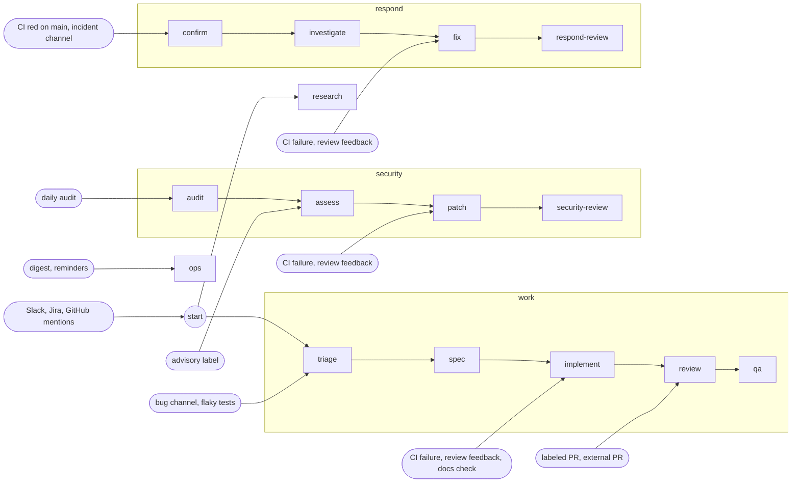

# Warp Factories reference factory

An example factory definition for [Warp Factories](https://docs.warp.dev/factories/). It starts from the default factory that onboarding creates and adds to it: automations that start work at a specific stage, an independent QA stage in the work track, a security lane, a respond lane, an ops stage, and skills loaded from a shared library.

This example is for a factory connected to GitHub, Jira, and Slack. Its automations, labels, and prompts are written for those three. Factories also connect to Microsoft Teams, GitLab, Azure DevOps, Linear, custom webhooks, and more. See [Connect your factory](https://docs.warp.dev/factories/connect-your-factory/) for those integrations.

Use it as a source of parts. You do not copy the whole repository. You create your own factory first, then have an agent bring in the parts you want.

## How to use it

1. Create a factory with the Warp Factories onboarding flow. See the [Warp Factories quickstart](https://docs.warp.dev/factories/quickstart/). Onboarding gives you the default factory, with your own name, repositories, and integrations. That default is what this repository starts from.
2. Decide which parts you want. [Adapting it](#adapting-it) lists them: stage automations, independent QA, the security lane, the respond lane, ops, and shared skills.
3. Point an agent at this repository and tell it which parts to bring into your factory. There are two ways to do that:
   - **Factories web chat** - Open a [new chat in the Warp Factories web app](https://platform.warp.dev/runs/new), choose your factory, and send the request. Your factory does the work as a task.
   - **A local agent with Factory MCP** - Connect your coding agent to [Factory MCP](https://docs.warp.dev/factories/factory-mcp/). In Warp, the connection is already there. The agent can then read the factory definition schema, validate the definition files, and send work to your factory.
4. Review the change the agent proposes before it lands. Then enable the new automations a few at a time.

Here is a sample prompt to use. Replace the <COMPONENT> with specific parts to bring in (like QA):

```text
Read the README in https://github.com/warpdotdev-demos/warp-factories-reference.

Adapt the <COMPONENT> part(s) to this factory's definition. Read the copy the needed files from the example repo, figure out what changes need to be made and apply edits to this factories config. Replace every placeholder with my factory's values. Keep my factory's model settings as they are and have new workers use models already defined in my existing workers.

My Slack channels are:
#RESULTS_CHANNEL for results and digests
#BUGS_CHANNEL for bug reports
#INCIDENTS_CHANNEL for incident reports.

Before you change anything, show me the blueprint changes, including the stages added and where their edges connect, automations, skills, and other changes vs. the existing factory config files.
```

## The blueprint

The blueprint in [`factory.yaml`](factory.yaml) defines the stages, which worker runs each one, and the edges between them.



- **`research`** - Answers one bounded question, read-only. From the default factory.
- **`work`** - The default work track. One worker takes a request through triage, an optional spec, implementation, and a review of its own change. This template adds a `qa` stage at the end: a separate QA worker runs the change, posts a report, and assesses merge risk. A failed check sends the pull request back to `implement`, at most twice. A change that skips review also skips QA.
- **`security`** - For dependency advisories. A daily audit files what is new, each advisory is assessed against what the repository actually resolves, and an affected one gets the smallest verified upgrade as a pull request.
- **`respond`** - For things that are broken right now. It confirms the problem, finds the change that caused it, and opens a revert or a bounded fix as a pull request. It never deploys or rolls anything back.
- **`ops`** - A stage the foreman runs itself for a weekly digest and reminders.

A human merges every pull request. Each of `work`, `security`, and `respond` ends at a `handoff` gate, where the foreman presents the pull request and waits for the merge decision.

### Stages

| Stage | Worker | What it does |
| --- | --- | --- |
| `research` | Researcher | Answers one bounded question, read-only |
| `triage` | Task-Worker | Finds existing work, records the issue, decides what comes next |
| `spec` | Task-Worker | Interviews the requester and commits a spec for approval |
| `implement` | Task-Worker | Makes and verifies the change, delivers a pull request |
| `review` | Task-Worker | Adversarial review of its own change |
| `qa` | QA | Runs the change, posts a report, assesses merge risk |
| `audit` | Security | Scans dependencies and files new advisories |
| `assess` | Security | Decides whether an advisory affects the repository |
| `patch` | Security | Opens the smallest verified upgrade as a draft pull request |
| `security-review` | Security | Adversarial review of its own upgrade |
| `confirm` | Responder | Checks that the problem is real and still happening |
| `investigate` | Responder | Finds the change that caused it and decides the remedy |
| `fix` | Responder | Opens the revert or the bounded fix as a draft pull request |
| `respond-review` | Responder | Adversarial review of its own revert or fix |
| `ops` | Foreman | Digests and reminders |

The three review stages share one prompt, [`stages/review.md`](stages/review.md). Stage names must be unique across a blueprint, so each lane has its own name for its review.

### Gates

A gate pauses a stage until a human answers. The foreman relays every ask and every answer.

| Gate | On | Opens when |
| --- | --- | --- |
| `scoping` | `triage`, `spec`, `implement` | The goal is unclear or a choice about the work is open |
| `approval` | `spec` | A new or revised spec is committed |
| `human` | `investigate` | The cause is not proven, or the remedy would be hard to undo |
| `handoff` | `work`, `security`, `respond` | A pull request is ready for a merge decision |

## How work enters the blueprint

An automation delivers its event to the foreman. What happens next depends on one field in the automation.

- **No `stage`** - The foreman follows the blueprint's entry edges: `research` for a bounded question, `work` otherwise. Use this for requests whose kind is not known in advance, such as a mention in Slack.
- **`stage: <name>`** - The foreman enters the blueprint at that stage and skips the entry edges. Use this when the event itself says where the work belongs: a failed build on the default branch belongs at `confirm`, an advisory at `assess`, a review on a pull request at the stage that revises it.

A stage does not need an edge from `start` to be entered by name. Here the `security` and `respond` lanes and the `ops` stage are entered only by automations.

## Automations

The factory has 24 automations. The nine from the default factory are enabled. The 15 this template adds ship disabled, so nothing new starts until you enable it.

| Automation | Trigger | Enters |
| --- | --- | --- |
| `Slack DMs` | A direct message to the factory | `start` |
| `Slack app mentions` | The factory is mentioned in Slack | `start` |
| `Jira agent sessions` | A Jira agent session in `ENG` | `start` |
| `Jira app mentions` | The factory is mentioned on an issue in `ENG` | `start` |
| `GitHub mentions and assignments` | The factory is mentioned or assigned on a labeled issue or pull request | `start` |
| `GitHub issue labeled` | An issue gets the factory label | `start` |
| `GitHub PR labeled` | A pull request gets the factory label | `review` |
| `GitHub PR review submitted` | A review on a work-track pull request | `implement` |
| `GitHub PR closed or merged` | A factory pull request is merged or closed | the foreman closes out the task |
| `Slack bug channel` | A message in `#bugs` | `triage` |
| `Weekly flaky test sweep` | Mondays 07:00 UTC | `triage` |
| `GitHub PR checks failed` | A workflow fails on a work-track pull request | `implement` |
| `Weekly docs check` | Mondays 08:00 UTC | `implement` |
| `GitHub external PR ready` | A pull request the factory did not open becomes ready for review | `review` |
| `Daily dependency audit` | Daily 06:00 UTC | `audit` |
| `Jira advisory labeled` | A Jira issue in `ENG` is labeled `factory-cve` | `assess` |
| `GitHub security PR checks failed` | A workflow fails on a security-lane pull request | `patch` |
| `GitHub security PR review submitted` | A review on a security-lane pull request | `patch` |
| `GitHub main branch checks failed` | A workflow fails on `main` | `confirm` |
| `Slack incident channel` | A message in `#incidents` | `confirm` |
| `GitHub respond PR checks failed` | A workflow fails on a respond-lane pull request | `fix` |
| `GitHub respond PR review submitted` | A review on a respond-lane pull request | `fix` |
| `Weekly stale PR reminders` | Mondays 09:00 UTC | `ops` |
| `Weekly digest` | Mondays 09:30 UTC | `ops` |

## Workers

| Worker | Role |
| --- | --- |
| `Engineering Foreman` | The only one that talks to people. It routes requests, relays gates, and asks for the merge decision. |
| `Engineering Researcher` | Answers bounded questions, read-only |
| `Engineering Task-Worker` | Owns a request through the work track |
| `Engineering Security` | Owns the security lane |
| `Engineering Responder` | Owns the respond lane |
| `Engineering QA` | Checks a work-track pull request independently of the worker that wrote it. It never changes the pull request. |

Onboarding names workers after the factory, and this factory is named Engineering. The first three are the default factory's. A worker's name is its directory name under [`workers/`](workers).

## Skills and where instructions live

Workers get their instructions from three places.

| Place | What belongs there | In this template |
| --- | --- | --- |
| The code repository | Anything true of the codebase no matter who works on it: how to build, test, and run it, and its conventions | Nothing is copied. Every stage that reads or runs code follows the repository's `AGENTS.md` (or `WARP.md`, `CLAUDE.md`) and uses its skills. |
| A shared skill library | Procedures that are the same in every repository | Three skill reference files load five skills from [`warpdotdev/common-skills`](https://github.com/warpdotdev/common-skills) at a pinned commit |
| The factory | Only what is about the factory itself | The seven default skills, and [`factory-conventions`](skills/factory-conventions/SKILL.md): the labels and tracker conventions the lanes share |

A skill reference file is a small YAML file in a `skills/` directory. It loads skills from another repository without copying them:

```yaml
# workers/Engineering QA/skills/common-skills.yaml
source: github.com:warpdotdev/common-skills@8792394ff1b655e0af451b8fabb68ef0cfcbd208
include:
  - merge-risk
```

- A file in [`skills/`](skills) applies to every worker. A file in `workers/<name>/skills/` applies to that worker only.
- Pin a full commit SHA, so a change in the library reaches the factory only when you update the pin.
- A reference that does not load does not stop a run, so each prompt that names a shared skill also says what to do without it.

| Reference file | Skills |
| --- | --- |
| `skills/common-skills.yaml` | `resolve-merge-conflicts` |
| `workers/Engineering Task-Worker/skills/common-skills.yaml` | `write-product-spec`, `write-tech-spec`, `implement-specs` |
| `workers/Engineering QA/skills/common-skills.yaml` | `merge-risk` |

## Labels

Automations route follow-up events by labels on the pull request.

| Pull request labels | Scope | CI failures and reviews enter |
| --- | --- | --- |
| `factory:eng` only | work | `implement` |
| `factory:eng` and `lane:security` | security | `patch` |
| `factory:eng` and `lane:respond` | respond | `fix` |

The work-track automations match `factory:eng` and exclude both lane labels, and each lane's automations match its own label, so one event starts one run.

QA sets one of `qa:passed`, `qa:failed`, `qa:not-reached` and one of `risk:low`, `risk:medium`, `risk:high` on each work-track pull request it checks. In Jira, the label `factory-cve` marks an issue as a dependency advisory.

## Adapting it

If your factory came from onboarding, you already have the default part. The first commit here, tagged `default-baseline`, is that default factory for a factory named Engineering with one GitHub repository, Jira, and Slack. Each addition is its own commit on top of it, so a commit's diff shows the files it adds and the few edits it makes to existing files:

```bash
git log --oneline default-baseline..HEAD
git show <commit> --stat
git diff default-baseline -- factory.yaml
```

| Part | Files | Edits to existing files |
| --- | --- | --- |
| Stage automations | The five automations that enter `triage`, `implement`, or `review`: `Slack bug channel`, `Weekly flaky test sweep`, `GitHub PR checks failed`, `Weekly docs check`, `GitHub external PR ready` | None |
| Independent QA | `workers/Engineering QA/`, `stages/qa.md` | In the `work` scope of `factory.yaml`, an accepted review goes to the new `qa` stage, and the `handoff` gate reports the QA result; a short section in the foreman prompt; a line each in the task worker prompt and `stages/implement.md`; the worker in scorers |
| Security lane | `workers/Engineering Security/`, `stages/audit.md`, `stages/assess.md`, `stages/patch.md`, and the four automations that enter `audit`, `assess`, or `patch` | The `security` scope appended to `factory.yaml`; `lane:security` excluded in `GitHub PR review submitted` and `GitHub PR checks failed`; a line in the foreman prompt; the worker and the `patch` stage in scorers |
| Respond lane | `workers/Engineering Responder/`, `stages/confirm.md`, `stages/investigate.md`, `stages/fix.md`, and the four automations that enter `confirm` or `fix` | The same kinds of edit, for the `respond` scope, `lane:respond`, and the `fix` stage |
| Ops | `stages/ops.md`, and the two automations that enter `ops` | The `ops` stage in `factory.yaml`; a line in the foreman prompt |
| Shared skills | The three `common-skills.yaml` files | A paragraph in `stages/spec.md`; lines in the skills lists of the stages that use them |

QA and the two lanes share one skill, `skills/factory-conventions/`, which holds the labels and tracker conventions. Bring it with whichever of them you take.

Replace these placeholders with your own values:

| Placeholder | Meaning |
| --- | --- |
| `Engineering` | The factory's name, which is the prefix of every worker's name |
| `your-org/your-repo` | The code repository |
| `eng` | The factory's alias, also in the label `factory:eng` |
| `ENG` | The Jira project key |
| `#engineering` | The Slack channel for the digest and for results nobody asked for |
| `#bugs` | A Slack channel where every new post is a bug report |
| `#incidents` | A Slack channel where every new post reports something broken now |

When you adapt a part:

- Merge its stages into your blueprint; do not replace your blueprint. Rename a stage if you already use its name, and update the edges and automations that name it.
- Keep your own copies of the default skills and prompts, and apply the edits above to them. Your default files may differ from the ones here.
- Keep your own model settings. The workers this template adds set no model, so they use your factory's default.
- If your factory uses a different chat tool, issue tracker, or code host, change each automation's trigger to that integration's events, and update the tracker and label conventions in `skills/factory-conventions/`. [Connect your factory](https://docs.warp.dev/factories/connect-your-factory/) lists the integrations and links to each one's guide.
- Create the labels in your code repository before you enable an automation that filters on one.
- Enable automations a few at a time, and check that one event starts one run at the stage you expect.

## Layout

```text
factory.yaml      settings and the blueprint: every stage, edge, and gate
workers/          one directory per worker, with its prompt and its skill reference files
stages/           one prompt per stage procedure
automations/      one directory per automation
skills/           skills every worker can use, and one skill reference file
scorers/          the default scorers
runners/          the default runner
```
